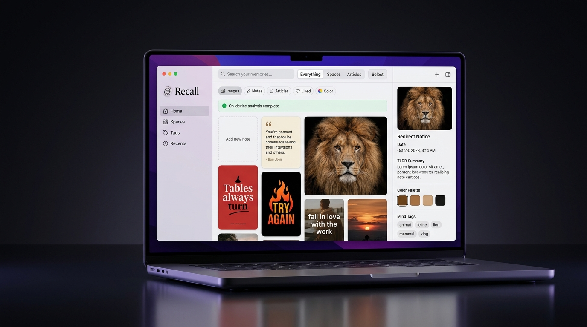
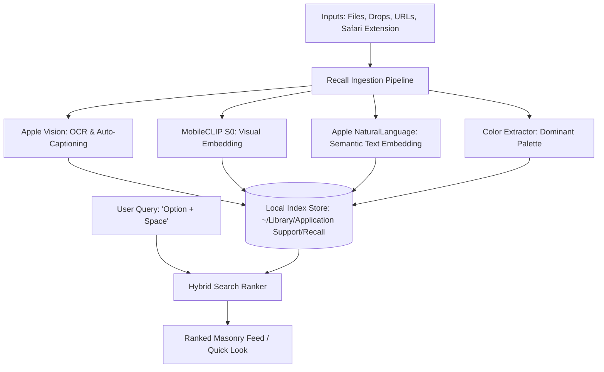

# Recall 🧠

> **Private, local-first visual memory library for macOS.**  
> Save images, documents, screenshots, and notes—then rediscover them instantly through visual browsing and multimodal associative search.

---

[](https://www.apple.com/macos)
[](web/)
[](https://swift.org)
[](https://support.apple.com)
[](LICENSE)
[](https://github.com/ProgramLife25/recall/releases/latest)

---

<p align="center">
  
</p>


## 📑 Table of Contents

- [Overview](#-overview)
- [Key Features](#-key-features)
- [How It Works](#-how-it-works)
- [Requirements](#-requirements)
- [Installation & Quick Start](#-installation--quick-start)
  - [Option A: 1-Click Installer (.dmg - Recommended)](#option-a-1-click-installer-dmg---recommended)
  - [Option B: Run with Swift Package Manager](#option-b-run-with-swift-package-manager-developer-mode)
  - [Option C: Build Standalone macOS App or DMG](#option-c-build-standalone-app-or-dmg-locally)
- [Safari Integration](#-safari-integration)
  - [Safari Extension](#safari-extension)
  - [Safari Bookmarklet](#safari-bookmarklet)
- [Usage & Navigation](#-usage--navigation)
  - [Capturing Content](#capturing-content)
  - [Keyboard Shortcuts](#keyboard-shortcuts)
  - [Search Syntax & Power Filters](#search-syntax--power-filters)
  - [Views & Modes](#views--modes)
- [Architecture & Privacy](#-architecture--privacy)
- [Configuration & Storage](#-configuration--storage)
- [Troubleshooting](#-troubleshooting)
- [Contributing & Roadmap](#-contributing--roadmap)
- [License](#-license)

---

## 🌟 Overview

Recall is designed to be your second brain's visual cortex. Rather than forcing you to organize files into rigid folder hierarchies or remember exact filenames, Recall lets you find anything using:

- **What you remember seeing** (colors, layout, visual objects via on-device Vision & MobileCLIP)
- **What text was inside** (on-device Apple Vision OCR)
- **What it meant** (on-device semantic text & visual embeddings)
- **When or how you saved it** (recency, file type, favorites, domains)

**Zero Cloud. Zero Subscriptions. Zero Telemetry.** Everything stays encrypted and local on your Mac.

---

## ✨ Key Features

### 🔍 Multimodal & Associative Search
- **On-Device OCR & Captions**: Instant high-accuracy text extraction and automatic image description using Apple's Vision framework.
- **MobileCLIP Image-Text Embeddings**: Search images using natural descriptive phrases (e.g., *"dark minimalist workstation"*, *"handwritten notes with diagram"*).
- **Apple NaturalLanguage Embeddings**: Semantic sentence embeddings that understand concepts and synonyms beyond exact keyword matches.
- **Color-Aware Retrieval**: Dominant-color extraction enables queries like `red sports car` or `dark navy design`.
- **Hybrid Multi-Factor Ranking**: Blends semantic similarity, OCR token matches, title matches, color heuristics, recency weighting, and favorite boosts into a single unified score.

### 🖼️ Fluid Visual Masonry Interface
- **Masonry Gallery**: Responsive, GPU-accelerated grid optimized for visual scanning.
- **Top of Mind**: One-click hearting keeps critical references and inspiration readily accessible.
- **Serendipity Mode**: Resurfaces forgotten inspiration and notes at random to spark creative connections.
- **Native Quick Look**: Press `Space` to inspect high-resolution previews instantly without leaving the app.

### 📥 Effortless Ingestion
- **Global Shortcut**: Press `Option + Space` anywhere to invoke Recall instantly.
- **Drag & Drop**: Drop images, PDFs, URLs, and text directly onto the window.
- **Safari Integration**: One-click save directly from Safari via Native App Extension or Bookmarklet.
- **Portable Markdown Notes**: Create quick rich notes stored as pure, un-sandboxed Markdown.

---

## 🏗️ How It Works



---

## 💻 Requirements

- **Operating System**: macOS 14.0 (Sonoma) or macOS 15.0 (Sequoia)+
- **Architecture**: Apple Silicon (M1/M2/M3/M4) recommended; Intel supported
- **Developer Tools**: Xcode 15+ or Xcode Command Line Tools (`xcode-select --install`)
- **Swift**: Swift 6.0 toolchain recommended (Swift 5.9+ minimum)

---

## 🚀 Installation & Quick Start

### Option A: 1-Click Installer (.dmg - Recommended)

For everyday users who just want to use Recall without touching the terminal or installing Xcode:

1. Download the latest **[Recall.dmg](https://github.com/ProgramLife25/recall/releases/latest)** from the Releases page.
2. Double-click the downloaded `.dmg` file.
3. Drag **Recall.app** into your **Applications** folder.
4. Launch **Recall** from Spotlight or your Applications folder!

---

### Option B: Run with Swift Package Manager (Developer Mode)

If you have Xcode or Command Line Tools installed and want to run directly from source:

```bash
git clone https://github.com/ProgramLife25/recall.git
cd recall
swift run Recall
```

---

### Option C: Build Standalone App or DMG Locally

To compile your own double-clickable `.app` bundle or package a new `.dmg` installer:

```bash
# 1. Compile Recall.app
chmod +x scripts/build-app.sh
./scripts/build-app.sh

# 2. Package into a distributable Recall.dmg installer
chmod +x scripts/create-dmg.sh
./scripts/create-dmg.sh

# The finished installer is saved under outputs/Recall.dmg
open outputs/Recall.dmg
```

> **Note on SDK mismatch**: If your Command Line Tools report an SDK version mismatch, select your macOS SDK:
> ```bash
> SDKROOT=/Library/Developer/CommandLineTools/SDKs/MacOSX.sdk ./scripts/build-app.sh
> ```

---

### Option D: Browser / Web Version (Cross-Platform PWA)

Recall is also available as a **cross-platform Web App & PWA** live at **[recall-web-puce.vercel.app](https://recall-web-puce.vercel.app)** (works in Chrome, Edge, Safari, and Firefox on macOS, Windows, Linux, iOS, and Android):

1. Run locally with the Python metadata/scraper server inside `web/`:
   ```bash
   cd web
   python3 server.py
   ```
   Then open [http://localhost:8080](http://localhost:8080) (or deploy `web/` directly to Vercel via `vercel.json` and `web/api/index.py`).
2. **Key Web Features**:
   - **Local-First + Real-Time Cloud Sync**: Instant IndexedDB storage with optional Google Sign-In (Firebase) for live cross-device sync.
   - **Rich Content Types**: Images/screenshots (Tesseract.js OCR + MobileCLIP), PDFs & arXiv papers, Excel/CSV/Google Sheets with interactive table search, Social posts (𝕏, Reddit, LinkedIn, Threads, Bluesky, Instagram), Code snippets & GitHub files/repos (Prism.js syntax highlighting), plus Spotify/YouTube embeds.
   - **Clipboard Paste & Drag-and-Drop**: Press `Cmd + V` / `Ctrl + V` anywhere to save screenshots, URLs, or code snippets directly.
   - **Installable PWA**: Click **Install** in your browser's address bar to run Recall as a standalone app.

---

## 🧭 Safari Integration

### Safari Extension
Recall includes a native Safari Web Extension that captures web pages, hero images, product metadata, and links via the custom `recall://save` URL protocol.

To package and install the extension:
```bash
./scripts/package-safari-extension.sh
```
1. Open the generated Xcode project in `SafariExtension/Xcode`.
2. Build and run the host application once.
3. Open **Safari → Settings → Extensions** and enable **Save to Recall**.

### Safari Bookmarklet
If you prefer not to compile an extension, open `SafariBookmarklet/install.html` in Safari and drag the bookmarklet button to your Favorites bar for instant 1-click clipping.

---

## 🎮 Usage & Navigation

### Capturing Content
- **Drag & Drop**: Drag images (PNG, JPEG, WebP, HEIC), PDFs, or text snippets straight into Recall.
- **Menu Bar / Add Button**: Click `+` to open the file picker or create a new Markdown note.
- **Clipboard / URL**: Clip directly from the web using Safari extension or bookmarklet.

### Keyboard Shortcuts

| Shortcut | Action |
| :--- | :--- |
| `Option + Space` | Toggle Recall global search window |
| `↑` / `↓` / `←` / `→` | Navigate masonry cards |
| `Return` / Double-Click | Open file in default system viewer |
| `Space` | Quick Look preview |
| `Cmd + R` | Reveal original item in Finder |
| `Cmd + Backspace` | Delete selected item from library |
| `Cmd + ,` | Open Recall Settings |
| `Esc` | Clear search query / Dismiss window |

### Search Syntax & Power Filters

Recall supports expressive, natural filter tokens combined with semantic search:

| Query Example | Description |
| :--- | :--- |
| `red architecture` | Uses color extraction + semantic visual match |
| `receipt type:pdf` | Restricts search to PDF documents containing receipts |
| `figma design type:image` | Searches image files for Figma layouts |
| `liked:true` | Shows all starred / favorited items |
| `today` / `yesterday` | Filters items saved within specific relative timeframes |
| `last week` / `last month` | Broad date range queries |
| `"exact phrase"` | Enforces strict string matching on OCR text and titles |

### Views & Modes
1. **Everything**: Complete chronological masonry grid of your entire memory archive.
2. **Top of Mind**: Filtered view showing only your starred items for quick reference.
3. **Serendipity**: Shuffled, associative discovery view to surface unexpected connections.

---

## 🔒 Architecture & Privacy

Recall adheres strictly to local-first principles:

- **No Remote Servers**: No telemetry, analytics, or remote API calls are executed during indexing or search.
- **Apple Native Frameworks**: OCR is executed via Apple Vision; embeddings are generated using Apple NaturalLanguage and local CoreML models (`MobileCLIP S0`).
- **Sandboxed File Permissions**: Only directories and files explicitly saved or granted by the user are indexed.

---

## 💾 Configuration & Storage

All persistent data is stored in standard macOS Application Support locations:

- **Library & Index Data**: `~/Library/Application Support/Recall/`
- **Cached Thumbnails**: Managed automatically using OS temporary cache policies.
- **User Notes**: Plain Markdown files stored locally so you can backup, edit, or sync via iCloud Drive, Git, or Syncthing.

---

## 🛠️ Troubleshooting

- **Option + Space doesn't open Recall**:  
  Another application (e.g., Alfred, Raycast, or Spotlight) may be bound to `Option + Space`. You can customize the shortcut in **Recall Settings** (`Cmd + ,`).
- **Permission Dialogs**:  
  macOS will request read permissions for folders (Desktop, Downloads, Documents) when files from those folders are imported. Grant permissions as prompted in **System Settings → Privacy & Security → Files and Folders**.
- **Model Files**:  
  Ensure CoreML models reside in `Models/MobileCLIP/` when running from custom builds.

---


---

## 🤝 Contributing

Contributions are warmly welcome! To get started:

1. Fork the repository.
2. Create your feature branch (`git checkout -b feature/amazing-feature`).
3. Commit your changes (`git commit -m 'Add amazing feature'`).
4. Push to the branch (`git push origin feature/amazing-feature`).
5. Open a Pull Request.

---

## 📄 License

This project is licensed under the **MIT License** - see the [LICENSE](LICENSE) file for details.
