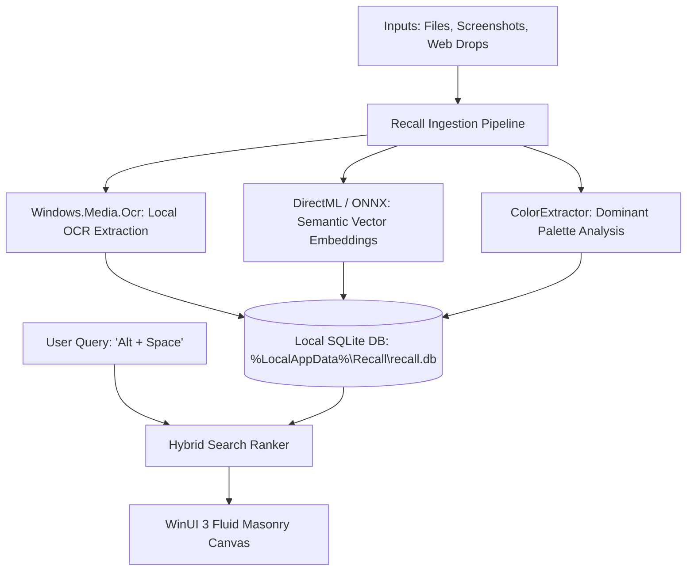

# Recall for Windows 🧠

> **Private, local-first visual memory library for Windows 11 & 10.**  
> Built with 100% native **C# / .NET 8, WinUI 3 (Windows App SDK)**, and **DirectML** hardware acceleration.

---

[](https://microsoft.com/windows)
[](https://dotnet.microsoft.com)
[](https://learn.microsoft.com/windows/apps/winui/winui3/)
[](README.md)
[](LICENSE)

---

## 🌟 Overview

Recall for Windows is the official native Windows counterpart to the macOS visual memory library. It lets you capture images, screenshots, PDFs, documents, and quick notes, and rediscover them instantly through visual browsing and associative hybrid search.

- **Zero Cloud**: 100% offline, local SQLite storage. No accounts, telemetry, or external APIs.
- **Native Windows Speed**: Built with WinUI 3 and DirectX hardware rendering.
- **Global `Alt + Space`**: Instant pop-up search launcher from anywhere in Windows.
- **Windows Media OCR**: Hardware-accelerated offline text extraction built straight into the Windows kernel.
- **DirectML GPU Acceleration**: Runs local multimodal vector embeddings on any AMD, Intel, or Nvidia graphics card.

---

## ✨ Key Features

- **Global Hotkey (`Alt + Space`)**: Invoke Recall anywhere in Windows without switching apps.
- **On-Device Windows OCR**: Extracts text from images and screenshots automatically using `Windows.Media.Ocr`.
- **Hybrid Multi-Factor Search**:
  - Semantic vector similarity (DirectML / ONNX)
  - Full-text OCR token matches
  - Exact phrase and title search
  - Dominant color filtering (e.g. `red sports car`, `dark interior`)
  - Recency and favorite weighting
- **Fluid Masonry Feed**:
  - **Everything**: Chronological visual memory grid.
  - **Top of Mind**: Starred / favorite reference cards.
  - **Serendipity**: Shuffled discovery mode to inspire creative connections.
- **Drag & Drop Ingestion**: Drop any image, screenshot, or PDF straight into the Recall window.
- **Markdown Quick Notes**: Capture thoughts as portable local Markdown files.

---

## 🏗️ Architecture



---

## 💻 Requirements

- **Operating System**: Windows 11 or Windows 10 (Build 19041 / Version 2004 or later).
- **Architecture**: `x64` (Intel/AMD) or `arm64` (Snapdragon X Elite / Surface Pro).
- **Developer Tools** (to build from source):
  - [.NET 8.0 SDK](https://dotnet.microsoft.com/download/dotnet/8.0)
  - [Visual Studio 2022](https://visualstudio.microsoft.com/) with **".NET Desktop Development"** and **"Windows App SDK"** workloads.

---

## 🚀 Building & Running

### Option 1: Visual Studio 2022 (Recommended)

1. Open `Recall.Windows.sln` in **Visual Studio 2022**.
2. Select your platform (`x64` or `arm64`) and configuration (`Debug` or `Release`).
3. Set `Recall.Windows` as the StartUp Project.
4. Press **F5** to build and run with full debugging!

---

### Option 2: 1-Click Command Line Build (`.bat` / `.ps1`)

From your command prompt or PowerShell:

```cmd
# Using Command Prompt:
build.bat

# Using PowerShell:
.\build.ps1
```

The script automatically restores NuGet packages and compiles a single, standalone executable:
```text
publish\win-x64\Recall.Windows.exe
```

---

## 🎮 Keyboard Shortcuts

| Shortcut | Action |
| :--- | :--- |
| **`Alt + Space`** | Toggle Recall search window globally |
| **`Double-Click`** / **`Enter`** | Open file in default Windows photo / document viewer |
| **`Esc`** | Clear search query / Dismiss window |
| **`Ctrl + N`** | Create a new Quick Note |

---

## 💾 Storage & Privacy

All user data is stored strictly on your local machine:

- **Database**: `%LocalAppData%\Recall\recall.db`
- **Saved Files & Captures**: `%LocalAppData%\Recall\Captures\`

---

## 📄 License

This project is licensed under the **MIT License**.
